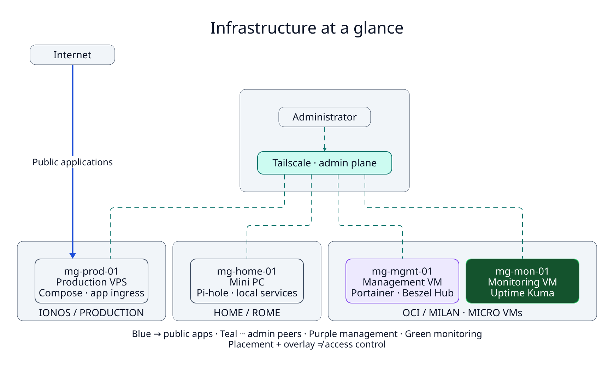

# MG Infrastructure

A self-hosted, multi-cloud infrastructure built with Docker, Tailscale and centralized observability.

**4 Nodes / 3 Locations**

Locations denote three placement contexts: home mini PC (Rome), IONOS production VPS, and OCI Milan.

Production applications run on IONOS, management and monitoring run on separate OCI micro VMs, and home services join the same private administration network.

<picture>
  <source media="(prefers-color-scheme: dark)" srcset="diagrams/rendered/infrastructure-overview-dark.svg">
  
</picture>

| Technology | Role | Engineering rationale |
| --- | --- | --- |
| Docker / Compose | Application and control-service deployment | Keeps a small estate straightforward to operate and troubleshoot |
| Tailscale | Private administration network | Connects hosts across home and cloud placement without an application gateway |
| Portainer | Central Docker management | Provides one management view for the four documented environments |
| Beszel | Central host telemetry | Separates resource visibility from application deployment |
| Uptime Kuma | HTTP and ping availability checks | Keeps the availability signal on a separate monitoring VM |
| Backrest | Backup capture mechanism | Separates data collection and snapshot capture from recovery validation |

Portainer centrally manages four Docker environments over a private Tailscale network. The owner's management dashboard showed all four endpoints Up; recovery testing remains future work.

## Decisions and their costs

**Compose before K3s.** Compose keeps deployment and troubleshooting understandable at this scale. Losing the production VPS loses its workloads: single-host production is not HA. A scheduler adds cluster operations without automatically solving data recovery or failover. K3s remains a planned experiment whose benefits must justify its cost. [ADR 004](docs/adr/004-compose-before-k3s.md)

**Separate production, management, and monitoring.** Control services do not consume the production host's resources. Monitoring runs apart from management so a management failure need not erase the signal. Each role still has a single host, and the two OCI VMs share a provider and location. Tailscale supplies the administration overlay; it does not by itself guarantee Internet isolation. [ADR 001](docs/adr/001-multi-cloud-split.md) · [ADR 002](docs/adr/002-administration-overlay.md) · [ADR 003](docs/adr/003-monitoring-isolation.md)

**Keep the micro VMs bounded.** Small OCI AMD VMs suit a narrow control-service footprint. CPU and memory headroom constrain expansion. Resource trends should guide additional services; OCI ARM capacity remains planned. [ADR 005](docs/adr/005-oci-micro-tradeoff.md)

**Design backups around recovery.** The design collects node data and selected database dumps into a production staging tree for Backrest capture. Collection, capture, and restoration are separate stages: a backup mechanism is not tested recovery. Coverage review and an isolated restore exercise are the next milestones. [Backup flow](diagrams/rendered/backup-dataflow.svg) · [ADR 006](docs/adr/006-backup-evidence.md)

## Explore and improve

- [Six architecture decisions](docs/adr/README.md) and [lessons learned](docs/lessons-learned.md)
- [Roadmap](docs/roadmap.md): telemetry validation, alert delivery tests, recovery exercises, capacity measurement, and planned K3s / ARM / logging experiments
- [Network](diagrams/rendered/network-topology.svg), [management](diagrams/rendered/management-architecture.svg), [monitoring](diagrams/rendered/monitoring-alerting.svg), and [workload](diagrams/rendered/services-workloads.svg) views
- [Seven D2 sources and reproducible builds](docs/diagrams.md), [public redaction policy](docs/redaction-policy.md), and [future publishing proposal](docs/publishing-proposal.md)

See [scope and provenance](docs/scope.md) for evidence details and [LICENSE](LICENSE) for reuse.

Contributors must review changed content and its exact hashes in `docs/public-review.json` before each commit; commit the reviewed files and manifest together. Run `make security` before committing and `make check-history` afterward; see the [review workflow](docs/redaction-policy.md). A ZIP can pass the current-file gate but cannot attest Git history.
